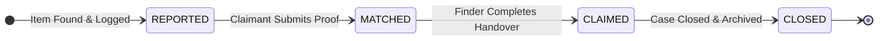

# Findly — Campus Lost & Found System

[](https://www.python.org/)
[](https://flask.palletsprojects.com/)
[](https://www.sqlite.org/)
[](https://docs.pytest.org/)
[](LICENSE)

**Findly** is a minimalist, secure campus lost-and-found web application designed to help students, faculty, and campus staff quickly report, track, and recover misplaced possessions. 

Featuring a deterministic, multi-phase verification state machine, Findly ensures that found items are returned safely to their rightful owners through verified proof-of-ownership before physical handover.

---

## 📑 Table of Contents

- [Key Features](#-key-features)
- [Verification Workflow (State Machine)](#-verification-workflow-state-machine)
- [Technology Stack](#-technology-stack)
- [Project Directory Structure](#-project-directory-structure)
- [Getting Started](#-getting-started)
  - [Prerequisites](#prerequisites)
  - [Installation & Virtual Environment](#installation--virtual-environment)
  - [Seeding Sample Campus Data](#seeding-sample-campus-data)
  - [Running the Application](#running-the-application)
- [Application Routes](#-application-routes)
- [Database Schema](#-database-schema)
- [Testing Suite (24 Test Cases)](#-testing-suite-24-test-cases)
- [Security & Privacy Design](#-security--privacy-design)
- [Contributing & License](#-contributing--license)

---

## 🌟 Key Features

- **📸 Photo Upload with Live Client Preview**: Upload item photos (`.png`, `.jpg`, `.jpeg`, `.gif`, `.webp`) with instantaneous client-side thumbnail preview before submission. Files are automatically renamed with cryptographic UUID prefixes to eliminate collision risks.
- **🔎 Instant Search & Status Filter**: Real-time keyword search spanning item titles, descriptions, and campus locations, coupled with category filter chips (`All`, `Reported`, `Matched`, `Claimed`).
- **🛡️ Proof-of-Ownership Safeguard**: Reporters log general visual descriptions while omitting private details (e.g., engraving, lock-screen wallpapers, wallet contents). Claimants must provide secret proof to verify ownership.
- **⚙️ Deterministic 4-Stage State Machine**: Strictly regulated transitions prevent accidental handovers, duplicate claims, or premature case closures.
- **📊 Visual Progress Tracker**: Dedicated 4-step progress indicator on every item details page gives clear transparency into the recovery phase.
- **🎨 Minimalist, High-Performance UI**: Clean typography built on the Inter font, custom CSS design variables, flexible card grid, and full mobile responsiveness with zero heavy front-end framework bloat.

---

## 🔄 Verification Workflow (State Machine)

To guarantee security and accountability, every item follows a non-reversible, deterministic state flow:



### Lifecycle Stages & Enforced Rules

| Stage | Status | Description | Permitted Action | Next State |
| :--- | :--- | :--- | :--- | :--- |
| **01** | `REPORTED` | Item logged by finder with public location and photo. Private details stay hidden. | Owner submits claim with name & secret proof | `MATCHED` |
| **02** | `MATCHED` | A potential owner has filed a claim. The finder reviews the proof of ownership. | Finder validates proof and hands item over in person | `CLAIMED` |
| **03** | `CLAIMED` | Physical item has been returned to the verified owner. | Final administrative sign-off | `CLOSED` |
| **04** | `CLOSED` | Case officially settled and permanently archived for record-keeping. | *None (Terminal State)* | *None* |

> **State Integrity Constraints**:
> - Items **cannot** skip states (e.g., `REPORTED` cannot directly jump to `CLAIMED` or `CLOSED`).
> - Once `MATCHED`, other users cannot overwrite the pending claim.
> - Once `CLOSED`, the item record is immutable and cannot be transitioned or reopened.

---

## 🛠️ Technology Stack

| Layer | Component | Description |
| :--- | :--- | :--- |
| **Backend** | [Python 3](https://www.python.org/) | Core programming language |
| **Framework** | [Flask 3](https://flask.palletsprojects.com/) | Lightweight WSGI web application framework |
| **Database** | [SQLite3](https://www.sqlite.org/) | Self-contained, serverless embedded relational database |
| **File Handling** | [Werkzeug](https://werkzeug.palletsprojects.com/) | Secure filename sanitization & multipart handling |
| **Testing** | [Pytest](https://docs.pytest.org/) | Automated test execution framework with 24 test cases |
| **Frontend** | HTML5 / CSS3 / Vanilla JS | Semantic markup, custom CSS design tokens, zero external JS libraries |
| **Typography** | [Inter](https://fonts.google.com/specimen/Inter) | Clean, modern sans-serif typeface |

---

## 📁 Project Directory Structure

```text
findly/
├── app.py                  # Core Flask app, route handlers, state machine logic
├── seed_db.py              # Database populator with 20+ realistic campus sample items
├── test_app.py             # Pytest suite with 24 black-box & unit tests (TC01-TC24)
├── requirements.txt        # Python package dependencies
├── lostfound.db            # SQLite database file (auto-created on first run)
├── test.db                 # Isolated test database (auto-generated during pytest)
├── pyrightconfig.json      # Python language server & linter configuration
├── README.md               # Project documentation
│
├── static/
│   ├── style.css           # Custom CSS design system (tokens, grid, cards, tracker)
│   └── uploads/            # Uploaded photos with UUID prefixing
│
└── templates/
    ├── base.html           # Master layout with header, navigation, and flash alerts
    ├── index.html          # Homepage with hero section, search, filter chips, and grid
    ├── item.html           # Item detail view, proof-of-ownership form, and progress tracker
    └── report.html         # Form to report found items with instant image preview
```

---

## 🚀 Getting Started

### Prerequisites

Ensure you have **Python 3.10+** (or 3.9+) and `pip` installed on your system:

```bash
python --version
pip --version
```

### Installation & Virtual Environment

1. **Clone or navigate to the repository**:
   ```bash
   cd findly
   ```

2. **Create and activate a virtual environment**:
   - **Windows (PowerShell)**:
     ```powershell
     python -m venv .venv
     .venv\Scripts\Activate.ps1
     ```
   - **Windows (Command Prompt)**:
     ```cmd
     python -m venv .venv
     .venv\Scripts\activate.bat
     ```
   - **macOS / Linux**:
     ```bash
     python3 -m venv .venv
     source .venv/bin/activate
     ```

3. **Install dependencies**:
   ```bash
   pip install -r requirements.txt
   ```

### Seeding Sample Campus Data

To populate the application with 20+ realistic campus lost items (e.g., student IDs, AirPods, scientific calculators, umbrellas, car keys, prescription glasses) and mock photos:

```bash
python seed_db.py
```

### Running the Application

Start the Flask development server:

```bash
python app.py
```

Open your browser and navigate to:
```text
http://127.0.0.1:5000
```

---

## 🌐 Application Routes

| Method | Endpoint | Description |
| :--- | :--- | :--- |
| `GET` | `/` | **Browse & Search**: Displays item grid, search bar, and status filter chips. |
| `GET` | `/report` | **Report Form**: Page to enter item details and upload an optional photo. |
| `POST` | `/report` | **Submit Report**: Validates fields, saves photo to `static/uploads/`, stores record in database. |
| `GET` | `/item/<id>` | **Item Detail**: Detailed item view, progress tracker, and context-dependent action buttons. |
| `POST` | `/item/<id>/claim` | **Claim Submission**: Claimant submits proof of ownership (`REPORTED` ➔ `MATCHED`). |
| `POST` | `/item/<id>/handover` | **Handover Confirmation**: Finder confirms handover after verifying proof (`MATCHED` ➔ `CLAIMED`). |
| `POST` | `/item/<id>/close` | **Close Case**: Case finalized and archived (`CLAIMED` ➔ `CLOSED`). |

---

## 🗄️ Database Schema

Findly uses an embedded SQLite database (`lostfound.db`) with automatic schema migration:

```sql
CREATE TABLE IF NOT EXISTS items (
    id INTEGER PRIMARY KEY AUTOINCREMENT,
    name TEXT NOT NULL,
    description TEXT NOT NULL,
    location TEXT NOT NULL,
    status TEXT DEFAULT 'REPORTED',
    claimant TEXT,
    proof TEXT,
    image TEXT
);
```

---

## 🧪 Testing Suite (24 Test Cases)

Findly includes a rigorous automated test suite (`test_app.py`) ensuring functional correctness, boundary enforcement, and state machine integrity.

### Running Tests

Execute the full test suite with verbose reporting:

```bash
pytest -v
```

### Test Case Coverage Matrix

| Test Case | Type | Description |
| :--- | :--- | :--- |
| `test_tc01_report_with_all_details` | Black Box | Reports item with complete valid information; checks status is `REPORTED`. |
| `test_tc02_report_empty_name` | Black Box | Verifies validation error when item name is omitted. |
| `test_tc03_report_empty_description` | Black Box | Validates rejection when description is empty. |
| `test_tc04_report_empty_location` | Black Box | Validates rejection when location is empty. |
| `test_tc05_report_only_spaces` | Black Box | Ensures whitespace-only inputs are rejected. |
| `test_tc06_home_page_with_no_items` | Black Box | Confirms clean rendering of homepage when zero items exist. |
| `test_tc07_newest_item_listed_first` | Black Box | Validates reverse-chronological ordering (`ORDER BY id DESC`). |
| `test_tc08_view_item_details` | Black Box | Checks item detail route status code and rendered content. |
| `test_tc09_view_missing_item` | Black Box | Confirms `404 Not Found` response for non-existent item IDs. |
| `test_tc10_claim_reported_item` | Black Box | Tests successful claim transition (`REPORTED` ➔ `MATCHED`). |
| `test_tc11_claim_with_empty_name` | Black Box | Verifies claimant name requirement. |
| `test_tc12_claim_with_empty_proof` | Black Box | Verifies proof of ownership requirement. |
| `test_tc13_claim_already_matched_item` | Black Box | Confirms items already in `MATCHED` cannot be claimed again. |
| `test_tc14_handover_matched_item` | Black Box | Validates transition from `MATCHED` to `CLAIMED`. |
| `test_tc15_handover_reported_item` | Black Box | Verifies illegal transition (`REPORTED` directly to `CLAIMED`) is blocked. |
| `test_tc16_close_claimed_item` | Black Box | Validates transition from `CLAIMED` to `CLOSED`. |
| `test_tc17_close_matched_item` | Black Box | Blocks premature closure (`MATCHED` directly to `CLOSED`). |
| `test_tc18_closed_item_cannot_change` | Black Box | Verifies immutability of `CLOSED` status. |
| `test_tc19_complete_lifecycle` | Black Box | Tests complete end-to-end journey: `REPORTED` ➔ `MATCHED` ➔ `CLAIMED` ➔ `CLOSED`. |
| `test_tc20_change_status_of_missing_item` | Black Box | Returns `"Item not found"` on non-existent records. |
| `test_tc21_every_allowed_change_works` | Unit Test | Direct state machine verification for every valid state progression. |
| `test_tc22_skipping_a_state_is_rejected` | Unit Test | Direct state machine assertion rejecting state skips. |
| `test_tc23_closed_has_no_next_state` | Unit Test | Verifies `NEXT_STATES["CLOSED"]` is empty. |
| `test_tc24_report_with_image` | Integration | Tests multipart file upload, storage in `static/uploads/`, and database record linkage. |

---

## 🔒 Security & Privacy Design

1. **Path Traversal & Collision Protection**:
   All uploaded files are sanitized using Werkzeug's `secure_filename()` and prepended with a cryptographically secure 8-character UUID hex prefix (`<uuid8>_<filename>`), preventing directory traversal and file overwrites.
2. **File Extension Whitelisting**:
   Strict enforcement of permitted image formats (`png`, `jpg`, `jpeg`, `gif`, `webp`).
3. **SQL Injection Prevention**:
   All database operations utilize parameterized queries (`?` placeholders) with SQLite3 bindings.
4. **Information Asymmetry for Ownership Proof**:
   To prevent fraudulent claims, reporters are instructed to keep distinctive marks confidential (e.g., student ID numbers, lock-screen backgrounds). The rightful owner must demonstrate knowledge of these details during the `claim` step.

---

## 📄 Contributing & License

Contributions, bug reports, and suggestions are welcome! Feel free to submit an issue or pull request.

This project is licensed under the **MIT License**.
